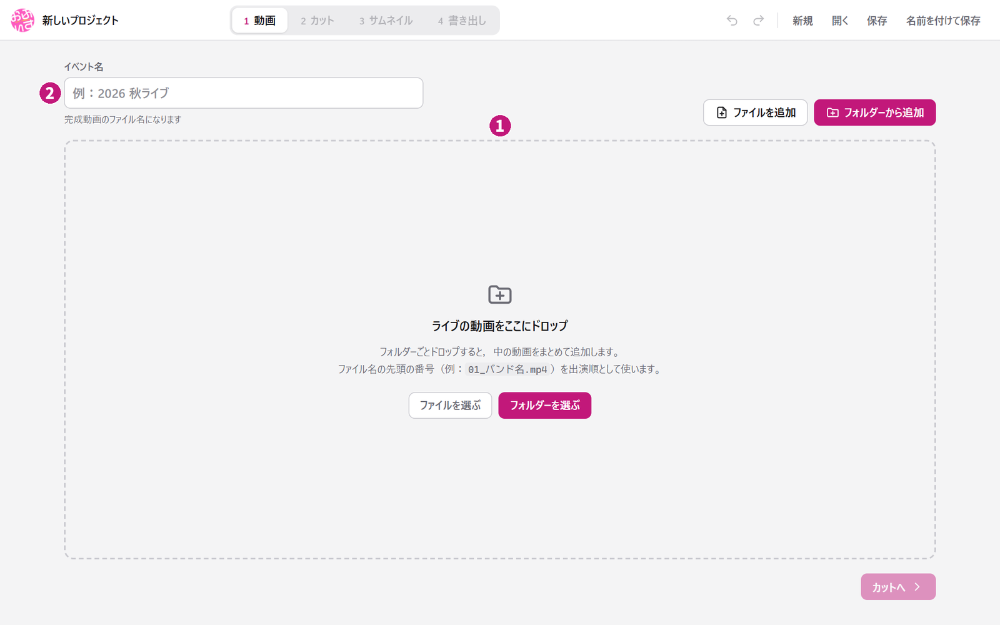
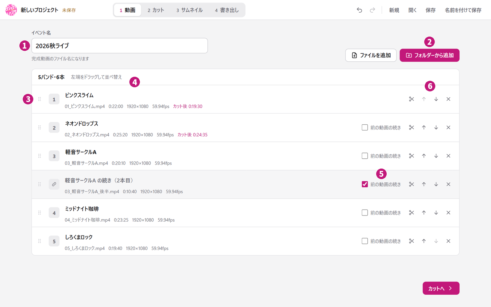
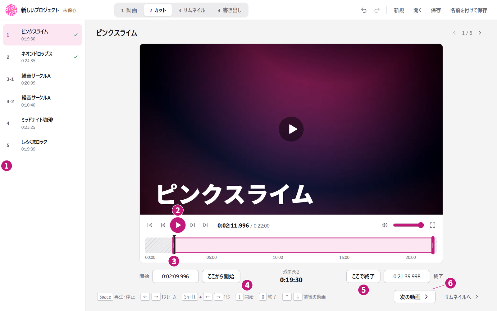
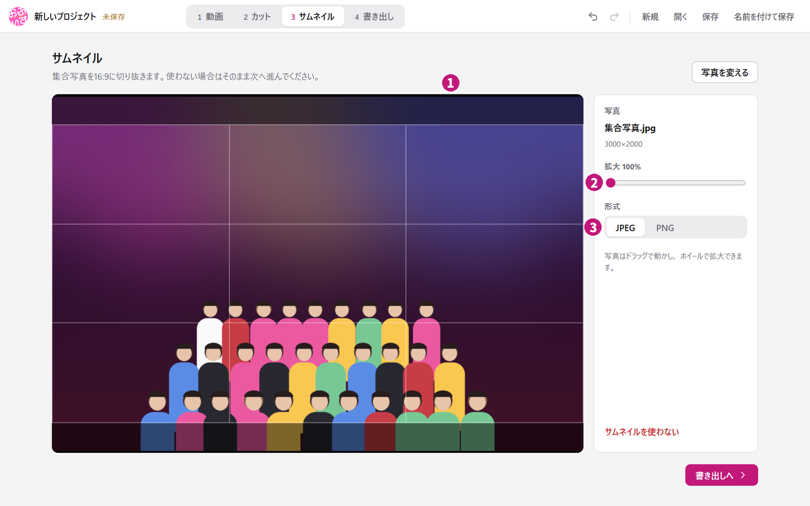
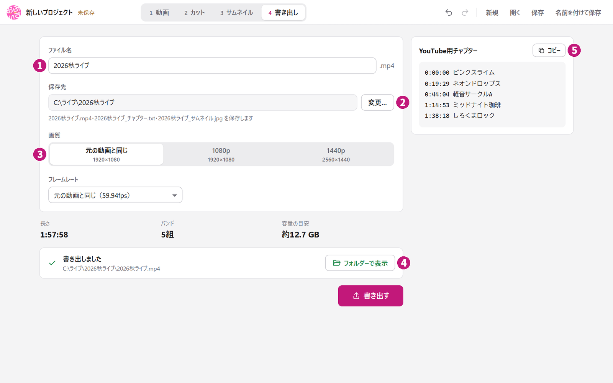

# ARTOFFICE広報動画作成ソフト

ライブ動画を出演順に並べ，前後をカットして1本にまとめるWindows・macOS用アプリ。バンド名の表示，バンド間のクロスフェード，YouTube用チャプター，集合写真からのサムネイル作成に対応する。元の動画は変更しない。

## ダウンロード

[v0.5.0のダウンロードページ](https://github.com/Yuto-0906/ARTOFFICE-video-maker/releases/tag/v0.5.0)を開き，「Assets」から自分のパソコンに合うファイルを選ぶ。

| パソコン | ダウンロードするファイル |
|---|---|
| Windows 10・11の64ビット版 | `ARTOFFICE-video-maker-v0.5.0-windows-x64.zip` |
| macOS 15以降，Apple Silicon（Mシリーズ） | `ARTOFFICE-video-maker-v0.5.0-macos-arm64.dmg` |
| macOS 15以降，Intel | `ARTOFFICE-video-maker-v0.5.0-macos-x64.dmg` |

Mac版は試験版。実機での画面操作，動画プレビュー，高速化は未確認。フォントと動画処理用ツールは同梱されており，追加インストールは不要。

### Windowsで初めて起動する

1. ダウンロードしたZIPを右クリックし，「すべて展開」を選ぶ。
2. 展開したフォルダーを開き，`ARTOFFICE-video-maker.exe`を起動する。ZIPの中から直接起動しない。
3. 「WindowsによってPCが保護されました」と表示されたら，このリポジトリのReleaseから取得したことを確認し，「詳細情報」→「実行」を選ぶ。

`tools`と`resources`も必要なため，アプリを移すときは展開したフォルダーごと移動する。

### Macで初めて起動する

1. 「このMacについて」で搭載チップを確認し，Apple Siliconならarm64，Intelならx64のDMG（ディスクイメージ）を選ぶ。
2. DMGを開き，アプリをApplicationsへドラッグする。
3. Applicationsから起動する。初回の確認が出たら配布元を確認して開く。

署名・公証済みのRelease版を使う。GitHub Actionsの`ci-unsigned`成果物は開発用。[実機確認表](docs/MAC_TEST_CHECKLIST.md)と[ビルド・署名の手順](docs/MAC_BUILD_AND_SIGNING.md)も参照できる。

## 使い方

画面上部の「1 動画」→「2 カット」→「3 サムネイル」→「4 書き出し」の順に進める。各図の丸数字と，直後のリストの番号が対応する。

### 1 動画



図中のバンド名と映像・写真は，説明用に作成した架空のサンプル。

1. 動画やフォルダーを枠内へドロップする。「フォルダーから追加」でまとめて選ぶか，「ファイルを追加」で動画を選んでもよい。
2. 「イベント名」を入力する。最初は読み込んだ動画のフォルダー名が入り，完成ファイルの名前になる。

同じライブの動画は1つのフォルダーにまとめておくと追加しやすい。対応する動画は`.mp4`，`.mkv`，`.mov`，`.webm`，`.mts`，`.m2ts`，`.avi`，`.wmv`。内部の映像・音声形式によっては読み込めない場合がある。

ファイル名は自由に付けられる。先頭に番号があれば出演順として使い，番号の後ろをバンド名として読み込む。番号がない動画は最後に並ぶ。

```text
01_ピンクスライム.mp4
02 ネオンドロップス.mov
3-軽音サークルA.mkv
```

読み込み後は次の画面になる。



1. イベント名を確認する。後の書き出し画面でも変更できる。
2. 足りない動画は「フォルダーから追加」か「ファイルを追加」で追加する。
3. 行の左端をドラッグし，出演順に並べ替える。
4. バンド名をクリックして直す。「カット後」は，カット後に残る長さを示す。
5. 1バンドの演奏が複数のファイルに分かれているときは，2本目以降を直前の動画のすぐ下に並べ，「前の動画の続き」にチェックを入れる。
6. はさみでその動画のカット画面を開く。上下の矢印でも並べ替えられる。×は一覧から外す操作で，元ファイルは消えない。

「前の動画の続き」を指定した部分はクロスフェードなしでつながる。バンド名とチャプターは1本目にだけ入り，並べ替えるときはひとまとまりで動く。

赤い線が付いた行は，表示された理由を確認して直す。準備ができたら「カットへ」を押す。

### 2 カット



1. 左の一覧から編集する動画を選ぶ。
2. 再生ボタンで映像を確認する。時間軸をクリックすると，その位置へ移動できる。
3. 時間軸の左右のつまみをドラッグし，残す範囲を調整する。
4. 残したい始まりで「ここから開始」を押す。開始時刻を直接入力し，Enterで確定してもよい。
5. 残したい終わりで「ここで終了」を押す。終了時刻も直接入力できる。
6. 「次の動画」で次へ進む。全て確認したら「サムネイルへ」を押す。

カットした動画には左の一覧でチェックが付く。再生用データが必要な動画では，位置を移動した直後に待ち時間が生じる。完成動画は元の動画から作られる。

### 3 サムネイル

写真をドロップするか，「写真を選ぶ」を押す。写真を使わない場合は，そのまま「書き出しへ」進める。



1. 写真をドラッグし，16:9の枠に収まる位置へ動かす。
2. 「拡大」のスライダーかマウスホイールで大きさを調整する。
3. 保存形式をJPEG（Joint Photographic Experts Group）かPNG（Portable Network Graphics）から選ぶ。「書き出しへ」で次へ進む。

読み込める画像の拡張子は`.jpg`，`.jpeg`，`.png`，`.heic`，`.heif`，`.webp`，`.tif`，`.tiff`，`.bmp`，`.avif`，`.gif`。`.gif`は先頭のコマを使う。選び直すときは「写真を変える」，作成をやめるときは「サムネイルを使わない」を押す。

### 4 書き出し



1. 完成動画のファイル名を確認する。
2. 保存先を確認する。初期値は一覧の1本目の動画と同じフォルダー。「変更…」で選んだ保存先はプロジェクトに記憶される。
3. 画質とフレームレートを選ぶ。通常は「元の動画と同じ」を使う。画質は1080p・1440pも選べる。下の「書き出す」を押し，完了を待つ。
4. 完了したら「フォルダーで表示」を押し，完成動画を確認する。
5. 右側の「コピー」を押し，チャプターをYouTube Studioの概要欄へ貼り付ける。

書き出せない理由はボタンの上に表示される。同名のファイルがある場合は，上書きするか確認される。処理が長くなる場合に備え，ノートパソコンは電源につなぐ。

保存先には次のファイルができる。

| ファイル | 内容 |
|---|---|
| `イベント名.mp4` | バンド名表示とクロスフェードを含む完成動画 |
| `イベント名_チャプター.txt` | YouTube概要欄へ貼り付けるチャプター |
| `イベント名_サムネイル.jpg`または`イベント名_サムネイル.png` | 16:9のサムネイル。写真を設定したときだけ作成 |

チャプターはテキストファイルからコピーしてもよい。先頭は`0:00:00`となる。YouTubeで表示するには，3件以上のチャプターがあり，各区間が10秒以上必要。

## キーボード操作

⌘はMacのCommandキー。カット画面のキー操作は，文字や時刻を入力していないときに使える。

| 操作 | Windows | Mac |
|---|---|---|
| 新規プロジェクト | Ctrl＋N | ⌘＋N |
| 開く | Ctrl＋O | ⌘＋O |
| 保存 | Ctrl＋S | ⌘＋S |
| 名前を付けて保存／別名で保存 | Ctrl＋Shift＋S | ⌘＋Shift＋S |
| 元に戻す | Ctrl＋Z | ⌘＋Z |
| やり直す | Ctrl＋Y，Ctrl＋Shift＋Z | ⌘＋Shift＋Z |
| 再生・一時停止（カット画面） | SpaceまたはK | SpaceまたはK |
| 1フレーム戻る／進む | ←／→ | ←／→ |
| 1秒戻る／進む | Shift＋←／→ | Shift＋←／→ |
| 今の位置を開始／終了にする | I／O | I／O |
| 開始位置／終了位置の3秒前へ移動 | Home／End | Home／End |
| 前／次の動画 | ↑／↓，PageUp／PageDown | ↑／↓，PageUp／PageDown |
| 全画面の切り替え | F | F |

## 保存と再開

上部の「保存」で編集内容を`.aovproj`ファイルへ保存する。一度保存すると，その後の変更は自動で上書き保存される。「保存済み」の表示で確認できる。最初の保存前に閉じる場合は，保存するか確認される。

「開く」でプロジェクトを選ぶと，続きから編集できる。v0.1.0～v0.4.0で保存したプロジェクトも開ける。「元に戻す」「やり直す」は上部の矢印ボタンでも使える。

プロジェクトファイルに元動画や写真は含まれない。編集が終わるまで移動・削除・名前変更をしない。動画を移動した場合は，「動画」の画面の「見つからない動画を探す…」で新しいフォルダーを選ぶ。

## 困ったとき

| 症状 | 確認すること |
|---|---|
| ZIPの中から起動できない | ZIPを右クリックし，「すべて展開」してから起動する。 |
| SmartScreenの警告が出る | このリポジトリのReleaseから取得したことを確認し，「詳細情報」→「実行」を選ぶ。 |
| Windowsで画面が開かない，真っ白になる | Windows Updateを実行する。改善しなければ[Microsoft WebView2 Runtime](https://developer.microsoft.com/microsoft-edge/webview2/)を導入する。 |
| 動画の順番が違う | 行の左端をドラッグして直す。黄色の番号は，他にも同じ番号の動画があることを示す。 |
| 分割動画の間にクロスフェードが入る | 後ろの動画を直前の動画のすぐ下へ並べ，「前の動画の続き」にチェックを入れる。 |
| 元動画が見つからない | 元の場所へ戻すか，「見つからない動画を探す…」で今のフォルダーを選ぶ。 |
| 書き出しが始まらない | ボタン上の指摘，保存先の空き容量，元動画を他のアプリが使用していないかを確認する。 |
| YouTubeでチャプターが表示されない | 3件以上あるか，各区間が10秒以上か，先頭が`0:00:00`かを確認する。 |
| エラーが出る | 内容をコピーまたは撮影し，操作手順と一緒に[Issues](https://github.com/Yuto-0906/ARTOFFICE-video-maker/issues)へ報告する。 |

## その他

### 更新と削除

Windowsではアプリを終了し，[最新版](https://github.com/Yuto-0906/ARTOFFICE-video-maker/releases/latest)のZIPを古いフォルダーとは別の場所へ展開する。新しいアプリでプロジェクトを開けることを確認してから，古いアプリのフォルダーを削除する。

Macではアプリを終了し，新しいDMGのアプリをApplicationsへコピーして置き換える。

削除するときは，Windowsでは展開したアプリのフォルダーを，MacではApplicationsのアプリを削除する。元動画，完成動画，プロジェクトはアプリのフォルダー外に保存しておく。

### 対応していないこと

- 複数カメラの切り替え編集
- 自動トリミング
- 完成動画の音量調整，色補正，字幕追加
- サムネイルへの文字入れ
- YouTubeへの直接アップロード
- アプリの自動更新

詳しい仕様は[使い方ガイド](docs/USER_GUIDE_JA.md)，今回の変更点は[リリースノート](docs/RELEASE_NOTES_0.5.0.md)を参照する。第三者ソフトウェアに関する表示は[THIRD_PARTY_NOTICES.md](THIRD_PARTY_NOTICES.md)にまとめている。
